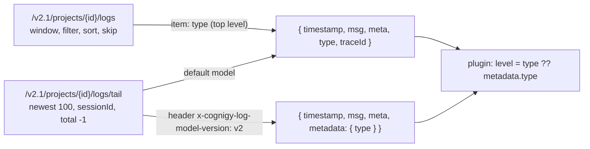
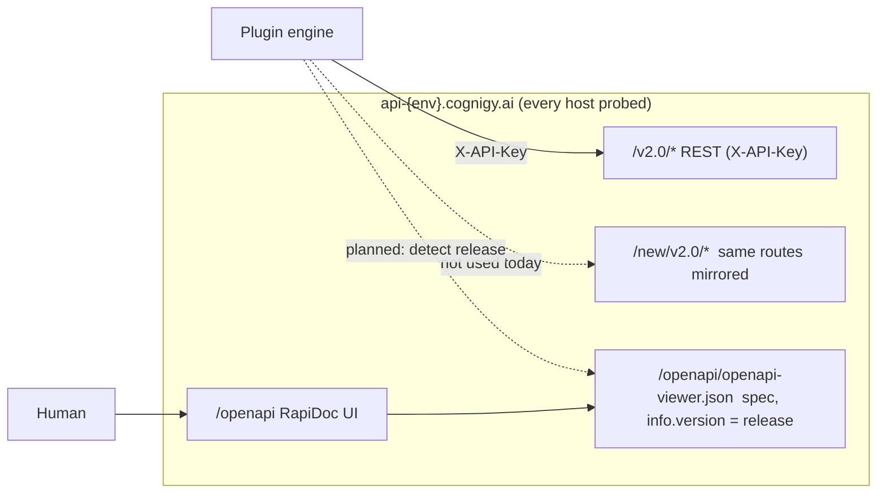

# Cognigy platform versions: findings log

Purpose: record what is actually known about how the classic ("v2") environments and the new ("v4")
environments differ, with the evidence behind each claim. v4 has very little public documentation, so
nothing here is assumed.

**Evidence classes**: `documented` (cite page) | `observed` (a request/response we made; shape in `probes/`) |
`inferred` (reasoning, may be wrong).

**Environments probed** (all GET-only; see `scripts/discovery/probe.mjs`)

| Profile                 | API host                                                 | Release (from its OpenAPI)             | Key accepted                                 |
| ----------------------- | -------------------------------------------------------- | -------------------------------------- | -------------------------------------------- |
| `v4-staging`            | `api-staging-v4.cognigy.ai` (UI `staging-v4.cognigy.ai`) | 2026.21.0 (Oct 12), 2026.21.1 (Oct 15) | yes                                          |
| `v2`                    | `api-trial-us.cognigy.ai`                                | 2026.20.1 (Oct 12), 2026.21.0 (Oct 15) | yes                                          |
| (earlier, wrong region) | `api-trial.cognigy.ai`                                   | 2026.21.0                              | no: 401 "Unable to authenticate via api key" |

Raw OpenAPI documents are kept outside the repo (about 5 MB each); this log carries the conclusions.

## Findings

| #   | Class      | Finding                                                                                                                                                                                                                                                                                                                                                                                                                                                                                      |
| --- | ---------- | -------------------------------------------------------------------------------------------------------------------------------------------------------------------------------------------------------------------------------------------------------------------------------------------------------------------------------------------------------------------------------------------------------------------------------------------------------------------------------------------- |
| F1  | observed   | v4-staging accepts the same `X-API-Key` header the plugin sends. The REST prefix is still `/v2.0/...`; `/new/v2.0/...` serves the same routes.                                                                                                                                                                                                                                                                                                                                               |
| F2  | observed   | v4-staging answers 200 on `/v2.0/` projects, locales, aiagents, flows, endpoints, largelanguagemodels, knowledgestores, connections and auditevents. So does the v2 host.                                                                                                                                                                                                                                                                                                                    |
| F3  | observed   | API reference UI is at `/openapi` (RapiDoc); the machine-readable spec is `/openapi/openapi-viewer.json` on every host tried. `/v2.0/openapi` and `/new/v2.0/openapi` return 404 (authenticated).                                                                                                                                                                                                                                                                                            |
| F4  | observed   | Classic `api-trial.cognigy.ai` and `v4-staging` publish **byte-different but operation-identical** specs: same release 2026.21.0, same 379 operations and 461 schemas, differing only in `servers[0].url`.                                                                                                                                                                                                                                                                                   |
| F5  | observed   | Classic `api-trial-us` (2026.20.1) vs `v4-staging` (2026.21.0): 378 vs 379 operations, 27 operations changed, 10 schemas added in v4-staging, 0 removed (details below).                                                                                                                                                                                                                                                                                                                     |
| F6  | observed   | Both hosts use the same RFC 7807 error envelope (`type,title,detail,instance,status,traceId,code,details`) and `x-cognigy-trace-id` header, behind CloudFront.                                                                                                                                                                                                                                                                                                                               |
| F7  | observed   | Live v4-staging `endpoints`: 3 of 3 items carry `agentId` and `targetType`; 0 of 6 classic items do. These fields are in neither release's spec, so v4-staging runs code **newer than its own published spec**. `aiagents.knowledgeReferenceId` is also v4-only (1 item each). Control: `projects.lastChangedByDisplayName` is v4-only live (1 vs 7 items) and IS in the 2026.21.0 spec, so spec-documented drift shows up live as expected. Sample is one project per host, up to 25 items. |
| F8  | observed   | The flow `kind` field (`conversation` or `tool`) and the `kind` filter on `GET /flows` and snapshot resources are in the 2026.20.1 spec but absent from the 2026.21.0 spec, yet live v4-staging flows still return `kind`. The spec lags behaviour.                                                                                                                                                                                                                                          |
| F9  | observed   | Neither release's OpenAPI document (2026.20.1 classic, 2026.21.0 v4-staging) contains an OAuth, device-code or authorize endpoint. The only security schemes are `X-API-Key`, an `api_key` query parameter, the CXone bearer header `x-cxone-authorization` ("CXone integrated environments only") and Basic Auth for the management UI. `/.well-known/openid-configuration` and `/.well-known/oauth-authorization-server` return 404 on both API hosts (`probes/*/.well-known_*`).          |
| F10 | documented | User API keys are created by hand in My Profile, API Keys (shown once, inheriting the user's permissions): https://docs.cognigy.com/ai/administer/user-menu/my-profile. The API overview also lists OAuth2 Client Credentials (non-interactive) for general API access: https://docs.cognigy.com/api-reference/about. No document found describing browser or SSO sign-in to obtain a key; nothing found confirming that CXone offers a device-code flow.                                    |
| F11 | observed   | Release drift is fast and moves both ways at once: between Oct 12 and Oct 15 the classic `api-trial-us` host went from 2026.20.1 to 2026.21.0 (the release `v4-staging` had on Oct 12) while `v4-staging` moved on to 2026.21.1. Read live through `list_environments` with `check: true`. Supports detecting the release per environment instead of trusting a `v2`/`v4` label.                                                                                                             |

### Project logs API (probed 2026-10-23 UTC, one classic-line production tenant, GET only)

| #   | Class      | Finding                                                                                                                                                                                                                                                                                                                                                                                                                                                                                                                     |
| --- | ---------- | --------------------------------------------------------------------------------------------------------------------------------------------------------------------------------------------------------------------------------------------------------------------------------------------------------------------------------------------------------------------------------------------------------------------------------------------------------------------------------------------------------------------------- |
| L1  | documented | `GET /v2.1/projects/{id}/logs` and `/logs/tail` (https://docs.cognigy.com/api-reference-logs); the same `X-API-Key` the plugin already sends works.                                                                                                                                                                                                                                                                                                                                                                         |
| L2  | observed   | Window query params that work in combination: `startDate`, `endDate` (ISO), `limit`, `skip`, `sort=timestamp:desc\|asc`, `filter`, `flowName`, `type` (array sent as `type[]=`; a plain string also works). `total` is exact on page 1. The default order is newest first, but undocumented, so the plugin always sends `sort`.                                                                                                                                                                                             |
| L3  | observed   | `limit` above 100 is not an error: the platform silently returns the default 25. `startDate` later than `endDate` and windows outside retention return 0 items without error. An unparsable date returns HTTP 500, so the plugin validates dates itself.                                                                                                                                                                                                                                                                    |
| L4  | observed   | `/logs/tail` returns the newest 100 with `total: -1`, honours `type` and `sessionId`, and silently ignores `filter`. With header `x-cognigy-log-model-version: v2` entries carry `metadata.type`; without it, top-level `type`.                                                                                                                                                                                                                                                                                             |
| L5  | observed   | Entry `meta` can hold the end user's text and an endpoint URL token, so the plugin copies only `flowId`, `flowName` and `channel`.                                                                                                                                                                                                                                                                                                                                                                                          |
| L6  | observed   | A made-up `sessionId` on `/logs/tail` returns 0 items, not an error. A window 72 to 74 hours old returned 0 items, so nothing older than about 3 days is served; the commonly quoted retention of about 24 h is `inferred` (not measured here, only consistent with that result).                                                                                                                                                                                                                                           |
| L7  | observed   | The session id `talk_to_agent` reports (`mcp-session-<uuid>`) is exactly what the logs store: one test-mode message (2026-10-23 UTC, one existing REST endpoint) gave 91 `/logs/tail` entries for that id after 6 s, and `meta.sessionId` equalled it. With the v2 header every entry has `metadata: { organizationId, projectId, type }`; without it, top-level `type`. Entry `meta` held `userId`, `projectName`, `text`, `traceId`, `sessionId` (no `flowId` on these entries, so the summary's `flows` list was empty). |
| L8  | observed   | One short exchange produced 91 entries, 87 of them the same info line "Sent output to Endpoint" (likely one per output chunk), so a session summary is dominated by it. Narrow with `logLevel` or `search` to see the rest.                                                                                                                                                                                                                                                                                                 |

### F5 detail: spec differences, classic 2026.20.1 -> v4-staging 2026.21.0

| Area             | Change in v4-staging                                                                                                                                                                           | Plugin relevance                                        |
| ---------------- | ---------------------------------------------------------------------------------------------------------------------------------------------------------------------------------------------- | ------------------------------------------------------- |
| Endpoints        | new channel `niceCXOneWebhook`; `handoverSettings.agentAssistSettings` gains `enableBranding`, `endSessionOnHandoverClose`, `sessionTTLOnHandoverClose`                                        | `manage_webchat`, `create_ai_agent` (endpoint creation) |
| Project settings | `GET/PATCH /projects/{id}/settings` gain `aiAgentSettings` (e.g. `routeToFlowToolEnabled`); GET gains `includeVoiceSettings`                                                                   | `manage_settings`                                       |
| Copilot          | `copilotConfigs` path param renamed `configId` -> `copilotConfigId`; new session and message endpoints (`.../session`, `.../session/message`); new voice test call and copilot session schemas | not covered by any current tool                         |
| Audit events     | `actor` filter gains value `api-key`                                                                                                                                                           | `list_resources` audit_event filter                     |
| Flows            | `kind` removed from spec (see F8)                                                                                                                                                              | `flow-nodes` skill, tool flows                          |
| Extensions       | `PATCH /extensions/{id}` removed; `trustedCode` marked deprecated; `extensionsTrust` right removed from ACL                                                                                    | extensions are not a plugin tool today                  |
| Misc             | `lexicons/{id}/entries` gains `filter`; `conversationcounter` channel enum changed; conversations/profile export channel enum gains `niceCXOneWebhook`                                         | none                                                    |

## Sign-in implications (inferred)

A browser-based "Connect to Cognigy" flow cannot be built client-side against what both releases publish today (F9, F10). A guided flow (open the environment UI, paste the key into a hidden prompt, verify it with `GET /v2.0/users/me`) and key self-rotation through `POST /v2.0/users/me/apikeys` are buildable now. True browser sign-in needs a platform capability such as an RFC 8628 device authorization grant that mints or returns a user key; to be confirmed with the platform team.

## What this means so far (inferred)

1. The classic-versus-v4 gap visible in the REST contract looks like **one release of drift** (2026.20.1 to
   2026.21.0), not a new API generation: the other classic host, already on 2026.21.0, is
   operation-identical to v4-staging (F4).
2. So the version axis the plugin needs is most likely **release (calendar version) plus feature
   capabilities**, detected per environment from `/openapi/openapi-viewer.json` (`info.version`), rather
   than a fixed `v2`/`v4` label. The profile name stays whatever the user chooses.
3. Dedicated v4 tools are **not yet justified**. Candidates, each needing more evidence: endpoint-to-agent
   targeting (`agentId`/`targetType`, F7), `aiAgentSettings` (F5), copilot sessions (F5).
4. Anything about v4 that is not an API change (UI, entitlements, behaviour behind feature flags) cannot be
   seen from the spec; ask the user what they have noticed.

## Host and route layout (observed)

## Open questions

1. What have you seen change in v4 that is not an API change (UI, new node types, entitlements)?
2. Are `endpoints.agentId`/`targetType` and `aiagents.knowledgeReferenceId` present on classic hosts for
   other item types? Needs larger samples (limit above 1) on both.
3. Is `api-trial` (EU, 2026.21.0) the same code as v4-staging, with "v4" meaning something outside the API?

## Next probes (read-only)

- Larger samples (limit 20+) per list endpoint on both hosts; union of keys per resource.
- Flow node catalog (`/flows/{id}/chart/nodes` descriptors) on both hosts: node types are the most likely
  place for runtime differences the spec does not show.
- `endpoints` item shape per `type`, and whether `targetType` can be something other than a flow.
- Project settings GET on both hosts to see `aiAgentSettings` live.
